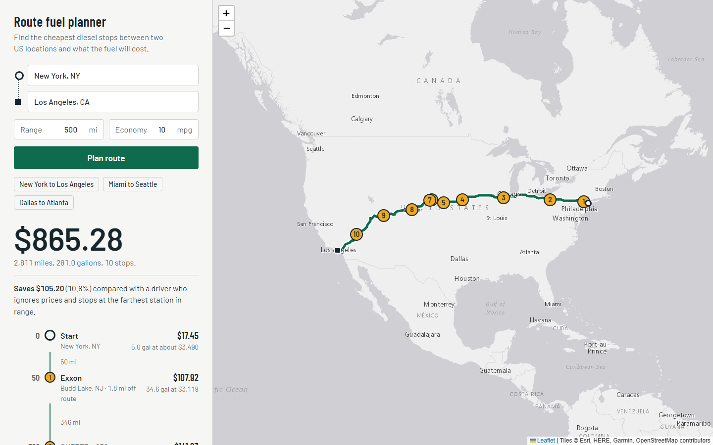

# Spotter Fuel Route API

[](https://github.com/Vatsal20042004/spotter-fuel-route/actions/workflows/ci.yml)

Django API that takes a **start** and **finish** inside the USA and returns the driving route, the
**cost-optimal fuel stops** along it (500-mile range), and the **total fuel cost** at 10 mpg, priced
from the supplied fuel-price file. Includes a map page (`/`) where the stops are laid out as a strip map, with gaps drawn in proportion to the miles between them.

## Live demo

| | |
|---|---|
| Map | https://spotter-fuel-route.onrender.com/ |
| API docs (Swagger) | https://spotter-fuel-route.onrender.com/api/docs/ |
| Endpoint | `POST https://spotter-fuel-route.onrender.com/api/route/` |

The free host sleeps when idle, so the first visit after a quiet spell can take up to a minute to wake.

```bash
curl -X POST https://spotter-fuel-route.onrender.com/api/route/ \
     -H "Content-Type: application/json" \
     -d '{"start": "New York, NY", "finish": "Los Angeles, CA"}'
```



| Requirement | How it is met |
|---|---|
| Latest stable Django | Django 6.1.3 + DRF 3.18 (pinned in `requirements.txt`) |
| Free map / routing API | OSRM public server (routing) + Nominatim (address lookup), no API key |
| Few map-API calls | **1 call** for `lat,lng` or `"City, ST"` input (resolved offline); **3 max** for arbitrary addresses; **0** when repeated (cached) |
| Fast | ~50–250 ms of compute for a coast-to-coast trip; the rest is the single OSRM round trip |
| 500-mile range, multiple stops | Exact greedy optimiser, never lets a leg exceed 500 miles |
| Total cost at 10 mpg | `summary.total_fuel_cost` = sum of gallons x price at each stop |
| Map | `GET /` interactive map; GeoJSON LineString in every response |

**Beyond the brief**

- **Savings figure.** Every response says how much the plan saves against a price-blind driver (about 9-12% on
  the sample trips) and against buying everything at the corridor average price. This is the business case in one number.
- **Any vehicle.** Optional `range_miles` and `mpg` per request, so the same API serves a fleet that is not all 500 mi / 10 mpg.
- **Honest per-stop data.** Each stop reports `detour_miles` off the route, plus `mile_marker`, gallons and cost.
- **City names cost nothing.** `"City, ST"` inputs are resolved offline from the Census data, so the typical request is a single routing call.
- **Resilient.** One automatic retry on transient provider errors; trips that fit in one tank work even with no station near the route.
- **Provably optimal.** The optimiser is checked against an exact dynamic-programming reference on random trips.
- **Production habits.** Input validation, typed error codes, throttling, caching, OpenAPI docs, Docker, CI, 68 offline tests.

## Run it locally

```bash
python -m venv .venv && source .venv/bin/activate        # Windows: .venv\Scripts\activate
pip install -r requirements-dev.txt
python manage.py migrate
python manage.py load_fuel_stations                      # ~6.4k stations from the CSV
python manage.py runserver
```

Then open <http://localhost:8000/> for the map and <http://localhost:8000/api/docs/> for Swagger.

Docker: `docker compose up --build`. Hosting: the live demo is deployed from `render.yaml`. Design notes and diagram: [`docs/DESIGN.md`](docs/DESIGN.md). Tests: `pytest` (68 tests, offline). Lint: `ruff check .`.
A Postman collection with assertions is in `postman/` and points at the live URL (change the `base_url` variable to use a local server).

## API

`POST /api/route/` (or `GET` with query params)

| Field | Notes |
|---|---|
| `start`, `finish` | `"City, ST"` (`"Austin, TX"` or `"Austin, Texas"`) or `"lat,lng"`: resolved offline, 1 external call total. Any other US address goes through Nominatim (+1 call each) |
| `range_miles`, `mpg` | Optional vehicle overrides (defaults 500 and 10) |
| `geometry` | `simplified` (default, ~2-mile spacing) or `full` router geometry |

Response (abridged):

```jsonc
{
  "route": {"distance_miles": 2794.0, "duration_hours": 49.8, "geometry": {"type": "LineString", "coordinates": [...]}},
  "fuel_stops": [{"order": 1, "name": "...", "city": "...", "state": "NE", "location": {"lat": .., "lng": ..},
                  "mile_marker": 851.2, "price_per_gallon": "2.9690", "gallons": 50.0, "cost": "148.45"}],
  "origin_fill_up": {"gallons": 4.519, "cost": "15.77", "note": "..."},
  "savings": {"price_blind": {"baseline_cost": "964.89", "you_save": "105.13", "percent": 10.9}, "corridor_average": {...}},
  "summary": {"total_fuel_cost": "859.76", "total_gallons": 279.4, "number_of_fuel_stops": 10, "currency": "USD", ...},
  "meta": {"external_api_calls": 1, "cache_hits": 0, "timings_ms": {...}}
}
```

Errors are `{"error": {"code", "message"}}`: `400` bad input / outside USA, `422` no route or no feasible
fuel plan (a gap over 500 miles with no station), `502` map provider unavailable.

## How it works

1. **Resolve + route** (`services/routing.py`): one OSRM request returns the full geometry and distance.
   Results are cached, so a repeat request makes no external calls.
2. **Locate stations offline** (`manage.py load_fuel_stations`): the CSV has no coordinates, so each station
   is placed once at its city's centroid using the free US Census Gazetteer (in `data/`). Geocoding 6.7k rows
   per request would blow the call budget. Rows are cleaned: padded whitespace trimmed, Canadian rows dropped,
   duplicate IDs merged (lowest listed price). 6,402 stations load; 224 whose city is not in the gazetteer are
   skipped rather than mis-located.
3. **Match stations to the route** (`services/spatial.py`): numpy grid prefilter + haversine keeps stations within
   5 miles of the route and gives each a **mile marker** along it (~ms).
4. **Optimise** (`services/optimizer.py`): the classic gas-station problem, solved exactly with a greedy rule. At
   each stop, if a cheaper stop is reachable on the current range, buy only enough to get there; otherwise fill up
   and go to the cheapest reachable stop. The destination acts as a free stop, so the last leg buys just what is needed.
   Verified against an exact dynamic-programming reference on random instances (`tests/test_optimizer.py`).

## Assumptions and trade-offs (please read)

- **Station location = city centroid.** The data has no coordinates; this is accurate to a few miles. A production
  system would geocode full addresses once (e.g. a paid batch geocoder) and store them in the same columns.
- **Origin fill-up.** No listed station sits at the start, so the first tank is priced at the average of stations
  within 100 miles of the start and reported separately as `origin_fill_up`. That way the total covers *all* fuel burned.
- **Practical tuning** (all env-configurable, `0` gives the strict optimum): a stop must save >= $0.05/gal to justify
  an extra stop, and purchases under 5 gallons are folded into the previous stop. The cost impact is bounded and tiny.
- Stations within 5 miles of the route count as on-route; the detour itself is not priced.
- Duplicate truckstop IDs carry different prices and no timestamp, so the lowest is kept.
- OSRM/Nominatim public servers are fair-use and rate-limited. They are fine for this exercise; set
  `OSRM_BASE_URL` / `NOMINATIM_BASE_URL` to self-host or use another provider.
