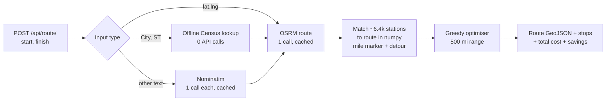

# Design notes

## Request flow

External calls per request: **1** for coordinates or "City, ST"; **3 at most** for arbitrary addresses; **0** when repeated.

## Why these choices

| Decision | Reason |
|---|---|
| Stations geocoded once, offline | The CSV has no coordinates. Geocoding at request time would blow the call budget and the latency target. |
| Census gazetteer instead of a geocoding API | Free, public domain, deterministic, no rate limits, works offline. Cost: city-level accuracy (a few miles). |
| numpy instead of PostGIS | 6.4k points fit in memory; a grid prefilter plus haversine matches a cross-country route in milliseconds, and the app runs on plain SQLite with no extensions. |
| Greedy optimiser | The fuel-stop problem on a line with a free fill amount has an exact greedy solution: buy just enough to reach a cheaper stop, otherwise fill up. Tested against an exact DP reference. |
| Decimal for money | Costs are summed in `Decimal` and rounded per stop, so the total always equals the sum of the line items. |
| OSRM behind one function | `fetch_route` is the only place that knows the provider; swapping to ORS/Mapbox or a self-hosted OSRM is an env var or a small adapter. |

## The optimiser in one paragraph

Stops are placed at mile markers along the route and the destination is a zero-price stop. Standing at a
stop: if a stop within range is cheaper by at least `MIN_PRICE_ADVANTAGE`, buy just enough fuel to reach it.
Otherwise nothing ahead is cheaper, so fill the tank and drive to the cheapest stop in range. A final pass
folds purchases under `MIN_PURCHASE_GALLONS` into the previous stop so a trip never stops for a few gallons.
With both knobs at 0 this is the strict optimum.

## Known limits and the production answer

| Limit | Production answer |
|---|---|
| Station position is the city centroid | Geocode full addresses once with a commercial batch geocoder; same columns, no code change |
| Detour is measured to the route, not priced | Add `detour_miles * 2 / mpg * price` to each stop's effective price in the optimiser |
| Static price snapshot | Load prices on a schedule (the loader is idempotent) and key the cache on a price version |
| Public OSRM is fair-use | Self-host OSRM (Docker) or use a paid tier; set `OSRM_BASE_URL` |
| Starts with an empty tank | The first fill-up is priced from nearby stations and reported as `origin_fill_up` |
| Hours-of-service not modelled | Out of scope for fuel cost; stops could later be aligned to driver break windows |
